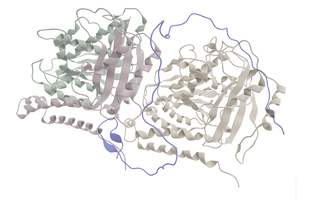
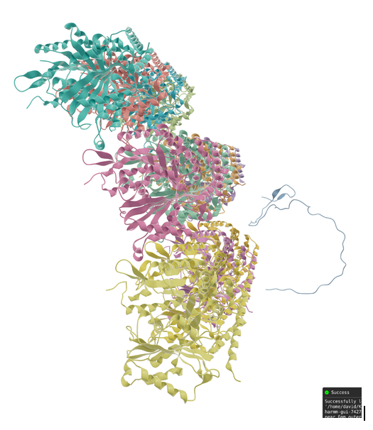

# Placement procedure

We start from the 10 ps NPT production run of EMB (NHL28) in the tubulin dimer: `step5_production_10ns.gro`

We rsync it to local, and then in VIAMD extract the EMB peptide, and save it as `emb_lastmodel.pdb`



we do the following to add a chain Z:

```
> python extract_emb_last_model.py  -i emb_lastmodel.pdb -o emb_lastmodel_chainZ.pdb --chain Z
```

Place both units together:
First, we need a shift on EMB:

```
> shift=$(python compute_shift_outer.py --tub tubulin_fixedchains.pdb --cc1 emb_lastmodel_chainZ.pdb --sep_nm 2.0 --side outer)
```
Then:
```
> gmx_mpi editconf -f emb_lastmodel_chainZ.pdb -o     emb_lastmodel_chainZ_shifted.pdb -translate $shift

>  awk '$1!="END"{print}' tubulin_fixedchains.pdb > complex_start_outer.pdb
>  echo "TER" >> complex_start_outer.pdb 
>  awk '$1!="END"{print}' emb_lastmodel_chainZ_shifted.pdb >> complex_start_outer.pdb
> echo "END" >> complex_start_outer.pdb
```

Fix `complex_start_outer.pdb`: remove MODEL, ENDMDL, etc. and join chain Z with the rest.


We fix missing residues with pdbfixer:

If not installed:
```
> conda create -p /cfs/klemming/projects/supr/naiss2024-23-646/myconda-envs/pdbfixer-env  -c conda-forge python=3.11 pdbfixer
```

Otherwise activate it:
```
> conda activate /cfs/klemming/projects/supr/naiss2024-23-646/myconda-envs/pdbfixer-env
> python fix_missing_atoms_only.py
Generates: complex_fixed_atoms.pdb
```

We generate "complex_near_6nm_outer.pdb" by translating only EMB (chain Z) so that the COM of EMB residues 24–30 ends up at a target separation (6.0 nm) from the COM of tubulin chain A residues 350–355, along the outer (radial) direction defined from the tubulin lattice axis:

```
> python  place_cc1_chainZ_outer.py --in_pdb complex_fixed_atoms.pdb  --out_pdb complex_near_8nm_outer.pdb  --sep_nm 8.0 --side outer
```



Then:
```
> python inster_ter_at_residue_gaps.py --in_pdb complex_near_8nm_outer.pdb --out_pdb complex_near_8nm_outer_TERfixed.pdb
```
